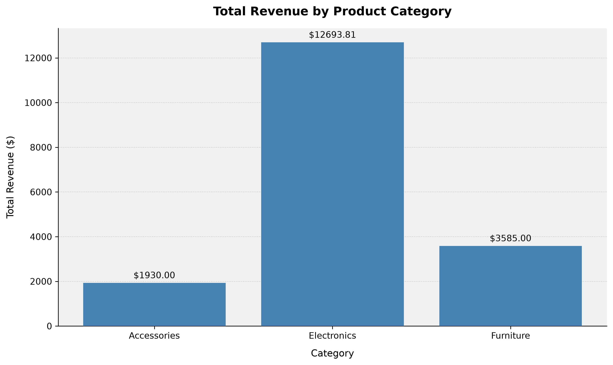

# E-Commerce Sales Analysis

A Python data analysis project that combines transaction and product data, calculates revenue, classifies order values, and visualizes revenue by product category.

## Overview

The script reads two CSV datasets, handles missing sales data, merges the datasets on `Product_ID`, and performs a simple sales analysis using **Pandas**, **NumPy**, and **Matplotlib**. Its final output is a bar chart of total revenue by product category.

## Features

- Load separate sales and product CSV files.
- Forward-fill missing sales values, then drop any remaining incomplete sales records.
- Join the datasets using `Product_ID`.
- Calculate revenue per transaction (`Quantity × Price_Per_Unit`).
- Label orders as **High Value** when revenue exceeds $100; otherwise, **Normal Value**.
- Aggregate revenue by product category.
- Generate and save a labeled bar chart.

## Tech Stack

- **Python**
- **Pandas** — data loading, cleaning, merging, and grouping
- **NumPy** — vectorized revenue calculations and conditional classifications
- **Matplotlib** — chart creation and export

## Required Input Files

The script expects two CSV files:

| File | Required columns | Purpose |
| --- | --- | --- |
| `Ecommerce_Sales.csv` | `Transaction_ID`, `Product_ID`, `Quantity` | Transaction records |
| `Ecommerce_Products.csv` | `Product_ID`, `Price_Per_Unit`, `Category` | Product prices and categories |

The uploaded project contains the Python script only; the CSV datasets are not included here.

**Important:** The current script uses absolute paths under `/workspaces/Junior-ML-AI-Portfolio/E-commerce market Analysis/`. Update the two `pd.read_csv(...)` calls to point to the location of your own CSV files before running it. For example, if the CSVs are in the same folder as your script:

```python
sales = pd.read_csv('Ecommerce_Sales.csv')
products = pd.read_csv('Ecommerce_Products.csv')
```

## Installation

Make sure Python 3 is installed, then install the dependencies:

```bash
pip install numpy pandas matplotlib
```

## Run the Project

Place the script and CSV files in your project directory, update the CSV paths as necessary, and run:

```bash
python "E-commerce Analysis.py"
```

## Analysis Workflow

### 1. Load and clean sales data

```python
sales = sales.ffill().dropna()
```

Missing sales values are forward-filled, and remaining rows with missing values are dropped.

### 2. Merge sales and product information

```python
df = sales.merge(products, on='Product_ID')
```

The default inner join retains only records with a matching product in both datasets.

### 3. Calculate transaction revenue

```python
df['Total_Revenue'] = df['Quantity'].to_numpy() * df['Price_Per_Unit'].to_numpy()
```

**Formula:** `Total_Revenue = Quantity × Price_Per_Unit`

### 4. Classify orders

```python
df['order_type'] = np.where(df['Total_Revenue'] > 100, 'High Value', 'Normal Value')
```

An order of exactly $100 is classified as **Normal Value**.

### 5. Analyze category performance

```python
category_revenue = df.groupby('Category')['Total_Revenue'].sum()
```

This provides total sales revenue by product category.

## Output

The script prints the merged dataset, transaction-level revenue, order classifications, and category revenue totals. It also saves:

- **`total_revenue_by_category.png`** — a 300 DPI bar chart of category revenue, with dollar-value labels.

After running, you can embed the generated chart in this README:

```markdown

```

## Project Structure

```text
E-commerce-Analysis/
├── E-commerce Analysis.py
├── Ecommerce_Sales.csv           # Required input (provide separately)
├── Ecommerce_Products.csv        # Required input (provide separately)
├── total_revenue_by_category.png # Generated on execution
└── README.md
```

## Limitations and Possible Improvements

- Input CSV paths are hard-coded and need adjustment outside the original workspace.
- Forward filling may not be appropriate for every missing field; validate missing-data assumptions.
- The analysis uses a fixed $100 classification threshold.
- No interactive filters, time-series analysis, or profitability calculations are implemented.
- Future extensions could include monthly sales trends, best-selling products, revenue KPIs, and a dashboard.

## Project Scope

This is a **descriptive data analysis and visualization** project. It does not train a machine learning model or forecast future sales.
