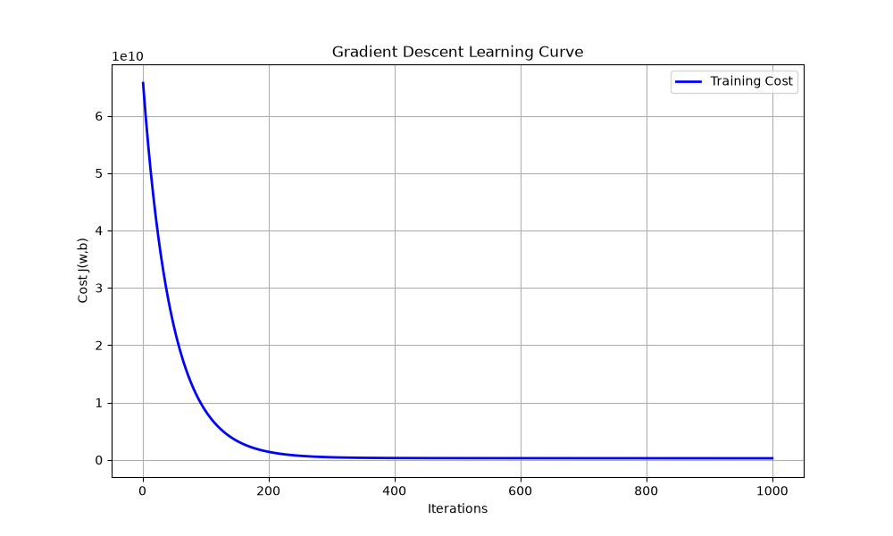

# House Price Prediction — Machine Learning from Scratch

A hands-on machine learning project that implements **linear regression**, **logistic regression**, and **L2-regularized linear regression** using NumPy. The project creates a synthetic housing dataset, engineers additional features, trains models with gradient descent, and visualizes the linear regression learning curve.

The learning algorithms are implemented manually rather than using a machine learning framework such as scikit-learn.

## Features

- Generate a reproducible synthetic dataset of **200 houses**.
- Perform feature engineering and **z-score normalization**.
- Predict continuous house prices with **multiple linear regression**.
- Classify houses by whether their price is **at least 350,000** using **logistic regression**.
- Apply **L2 regularization** to linear regression.
- Calculate a **two-feature logistic decision boundary** using size and bedrooms.
- Track training cost over iterations and save a **gradient descent learning curve**.

## Tech Stack

- **Python**
- **NumPy** — numerical operations and manual model implementation
- **Pandas** — dataset creation and manipulation
- **Matplotlib** — training-cost visualization

## Project Structure

```text
.
├── housing_prices.py          # Data generation, model training, and visualization
├── README.md                  # Project documentation
└── gradient_descent_curve.png # Generated when the script runs
```

## Dataset

The dataset is generated within `housing_prices.py` using `np.random.seed(42)` for reproducibility. It contains these columns:

| Column | Description |
| --- | --- |
| `size` | House size (random integer from 600 to 3,499) |
| `bedrooms` | Number of bedrooms (1–5) |
| `age` | House age (0–39) |
| `distance` | Distance feature (1–29; unit not specified) |
| `size_squared` | Square of house size |
| `size_per_bedroom` | House size divided by number of bedrooms |
| `house_age_squared` | Square of house age |
| `price` | Synthetic target house price |

The synthetic price is generated using:

```text
price = 50000 + 150 × size + 10000 × bedrooms
        - 1200 × age - 2000 × distance + noise
```

The noise is sampled from a normal distribution with mean `0` and standard deviation `20,000`. Prices are rounded to two decimal places.

For logistic regression, the continuous target is converted into a binary label:

```python
y_logistic = (data["price"] >= 350000).astype(int).values
```

- `1` = house price is at least 350,000
- `0` = house price is below 350,000

## Implemented Algorithms

### 1. Feature Normalization

Each input feature is normalized with z-score scaling:

$$
X_{normalized} = \frac{X - \mu}{\sigma}
$$

### 2. Multiple Linear Regression

Uses a linear prediction function:

$$
f_{w,b}(X) = Xw + b
$$

and minimizes mean squared error with the cost function:

$$
J(w,b) = \frac{1}{2m} \sum_{i=1}^{m}(f_{w,b}(x^{(i)}) - y^{(i)})^2
$$

The parameters are updated using batch gradient descent.

### 3. Logistic Regression

Uses the sigmoid function to predict the probability that a house meets the price threshold:

$$
\sigma(z) = \frac{1}{1 + e^{-z}}
$$

The model is trained by minimizing binary cross-entropy loss using gradient descent.

### 4. L2-Regularized Linear Regression

Adds a penalty to the linear regression cost to discourage large weights:

$$
J_{reg}(w,b) = J(w,b) + \frac{\lambda}{2m}\sum_j w_j^2
$$

The bias is not regularized. The script uses `lambda_=0.1`.

### 5. Decision Boundary

A second logistic regression model trains on the first two normalized features (`size` and `bedrooms`) and calculates the line:

$$
x_2 = -\frac{w_1x_1+b}{w_2}
$$

**Note:** The script calculates the decision-boundary coordinates but does not plot them.

## Installation and Usage

1. Make sure **Python 3** is installed.
2. Install the dependencies:

   ```bash
   pip install numpy pandas matplotlib
   ```

3. Run the project:

   ```bash
   python housing_prices.py
   ```

The script prints a preview of the dataset and the trained model weights, biases, and final training costs. It also displays the linear regression learning curve and saves it as:

```text
gradient_descent_curve.png
```

## Training Configuration

| Parameter | Value |
| --- | --- |
| Dataset size | 200 samples |
| Random seed | 42 |
| Learning rate (`alpha`) | 0.01 |
| Iterations | 1,000 |
| L2 regularization strength (`lambda_`) | 0.1 |
| Logistic classification threshold | 350,000 |

All models are trained on the generated dataset. The current script does **not** split data into training and test sets or report test-set evaluation metrics, so its printed costs should not be interpreted as generalization performance.

## Output Visualization

After running the script, the saved chart shows the **linear regression training cost across 1,000 gradient descent iterations**.



## Project Purpose

This project demonstrates core machine learning concepts by implementing their mathematical foundations directly with NumPy, including feature engineering, normalization, cost functions, gradients, optimization, classification, and regularization.

## Possible Future Improvements

- Add train/test splitting and evaluation metrics (MAE, RMSE, accuracy, precision, and recall).
- Visualize the logistic regression decision boundary.
- Compare manually implemented models against scikit-learn equivalents.
- Experiment with other learning rates and regularization strengths.
- Make predictions for new housing inputs.
