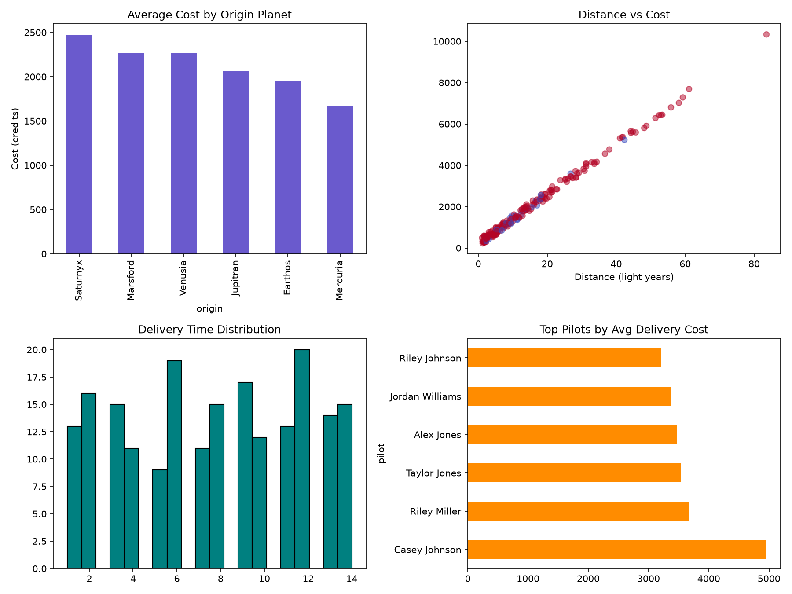

# Interplanetary Delivery Analysis

A Python analytics project that simulates deliveries between fictional planets, calculates shipping costs, measures delivery performance, and visualizes operational trends.

> **Note:** The source file is named `Solar Plantes Analysis.py`, but the code analyzes a fictional **interplanetary delivery network**, not real astronomical data.

## Overview

This project generates **200 synthetic deliveries** between six fictional planets. It uses a Python class to represent deliveries, creates a structured dataset, aggregates route-level and planet-level performance metrics, and exports a four-panel analytics dashboard.

## Features

- Generate reproducible synthetic deliveries using NumPy (`seed=42`).
- Assign origins, destinations, pilots, shipping distances, and package weights.
- Calculate a distance- and weight-based delivery cost with random noise.
- Simulate delivery durations and on-time delivery flags.
- Aggregate route metrics, including delivery counts, average costs, durations, and on-time percentages.
- Compare average shipping costs across origin planets.
- Calculate the overall on-time delivery rate.
- Create a dashboard with four visualizations.

## Tech Stack

- **Python** and basic object-oriented programming
- **NumPy** — synthetic data generation and numerical computations
- **Pandas** — tables, grouping, and KPI calculations
- **Matplotlib** — visual analytics

## Installation

Install Python 3 and the required packages:

```bash
pip install numpy pandas matplotlib
```

## Run the Project

No external dataset is required: the script generates its own data.

```bash
python "Solar Plantes Analysis.py"
```

A plot window will open, and the dashboard will be saved in the working directory.

## Simulated Dataset

The simulation uses these fictional planets:

`Mercuria`, `Venusia`, `Earthos`, `Marsford`, `Jupitran`, and `Saturnyx`.

The generated DataFrame contains:

| Column | Description |
| --- | --- |
| `delivery_id` | Numeric delivery identifier |
| `origin` | Origin planet |
| `destination` | Destination planet |
| `pilot` | Randomly generated pilot name |
| `distance_ly` | Simulated distance in light years |
| `weight_kg` | Package weight in kilograms |
| `cost` | Simulated delivery cost in credits |
| `delivery_days` | Simulated delivery duration in days |
| `on_time` | Randomly assigned on-time status |

**Simulation settings:** 200 deliveries, exponential distance sampling plus 1 light year, uniformly distributed package weights from 0.5 to 50 kg, delivery durations from 1 to 14 days, and a nominal 85% probability of an on-time flag.

## Cost Model

The `delivery` class provides a base cost calculation:

```python
def base_cost(self):
    return self.distance_ly * 120 + self.weight_kg * 8
```

**Base cost (credits)** = `120 × distance_ly + 8 × weight_kg`

The script adds normally distributed noise (standard deviation 15 credits), floors the result at 20 credits, and rounds to two decimal places.

## Key Metrics

The code aggregates deliveries by `(origin, destination)` to calculate:

- **Total deliveries** — count of records per route.
- **Average cost** — mean shipping cost per route.
- **Average delivery days** — mean delivery duration per route.
- **On-time percentage** — fraction of on-time deliveries multiplied by 100.

It also ranks origin planets by average cost and prints the overall on-time rate:

```python
on_time_rate = df['on_time'].mean() * 100
```

The resulting percentage may differ from 85% because the actual flags are randomly sampled.

## Dashboard

The script creates a **2 × 2 dashboard** containing:

1. **Average Cost by Origin Planet** — bar chart comparing typical shipment cost.
2. **Distance vs Cost** — scatter plot colored according to the on-time flag.
3. **Delivery Time Distribution** — histogram of delivery durations.
4. **Top Pilots by Avg Delivery Cost** — horizontal bar chart of the six highest average-cost pilots.

Saved output:

**`delivery_analysis.png`** — dashboard exported at 150 DPI.

Once generated, include it in the README with:

```markdown

```

## Project Structure

```text
Interplanetary-Delivery-Analysis/
├── Solar Plantes Analysis.py
├── delivery_analysis.png       # Generated on execution
└── README.md
```

## Limitations and Future Improvements

- The planets, routes, distances, costs, and performance metrics are entirely synthetic.
- The simulation currently allows an origin and destination to be identical; it checks and warns only for the first delivery.
- On-time status is assigned independently of travel distance and delivery duration.
- Pilot names may repeat, and the pilot ranking uses average cost, not operational quality.
- Route statistics are calculated but not printed or exported in the current script.
- Potential improvements include realistic delivery constraints, cost prediction, exportable summary tables, and an interactive dashboard.

## Project Scope

This is a **synthetic data simulation and exploratory data analysis** project; it does not predict costs using a trained machine learning model.
